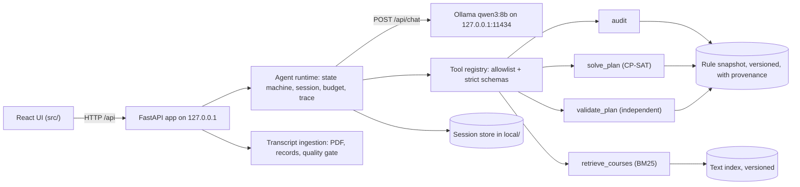

# Architecture

Target architecture for the UAT MVP (4 Nov 2026) and the final system (11 Nov 2026). It
extends pitch v9 slides 3-10 and 12-13 with the decisions in `decisions.md`. The frozen
`baseline/` implements the v9 two-term version on synthetic data.

## Components



| Component | Responsibility | Module (planned) |
|---|---|---|
| React UI | record review, goal card, chat, plan view, consent and blocker cards | `src/` |
| API | sessions, transcript upload and confirmation, messages, decisions; binds to 127.0.0.1 | `gradpath/api/` |
| Agent runtime | state machine, per-turn budget, tool dispatch, final gate, traces, run record | `gradpath/runtime/` |
| LLM client | Ollama chat with tools, `think: false`, per-call timeout equal to the remaining budget, model digest recorded | `gradpath/runtime/llm.py` |
| Tools | audit, retrieval, planner and validator, all deterministic | `gradpath/tools/` |
| Ingestion | PDF text extraction with coordinates, record normalizer, quality gate | `gradpath/ingest/` |
| Snapshot | load, hash and expose the rule snapshot with a status per item | `gradpath/snapshot.py` |

## State machine

Extends pitch v9 slide 6 with the interactive states.

| State | Guard or observation | Transition |
|---|---|---|
| VERIFY_INPUT | Are all required record fields resolved and confirmed by the student? | yes: CLARIFY; no: WAIT_USER with `NEED_INFO` and evidence |
| CLARIFY | Is the goal confirmed and complete (horizon, caps)? | yes: ACT; no: WAIT_USER with a question or a goal card |
| ACT | The LLM returns a tool call | regular tool: run it and stay in ACT; `ask_user`, `reply`, or `propose_goal` with a hard change: WAIT_USER; `submit_final`: FINAL_GATE |
| WAIT_USER | A student message or a UI decision arrives | update trusted state (a new `record_version` or `goal_version` only after approval), then CLARIFY or ACT |
| FINAL_GATE | Is the stored candidate valid for the current versions? | pass: DONE, or EVIDENCED_BLOCKER for witnessed infeasibility; fail: back to ACT, at most 2 revisions |
| STOP_UNVERIFIED | Budget exceeded, timeout, or solver `UNKNOWN` | return the uncertainty; never claim impossibility |

The budget applies per agent turn, from a student message to the response: at most 8 tool
calls, 2 final-gate revisions and 120 s of wall-clock time. Time spent waiting for the
student does not count. Each LLM call times out at the remaining budget.

## Data contracts

Extends pitch v9 slide 7 for multi-term plans. Contracts are pydantic v2 models (D9).

| Contract | Key fields | Invariant |
|---|---|---|
| StudentState | `student_ref` (opaque), `record_version`, `source` (kind, document SHA-256), `entry_year`, `current_term`, `records[]` (course_id, title, credits, grade, term, evidence: page, row, text), `unresolved_fields[]`, `confirmed_at` | Planning uses only a confirmed version with no unresolved required field |
| GoalConstraints | `goal_version`, `horizon_end_term`, `terms[]` (term, kind regular or summer, cap), `allow_summer`, `must_take[]`, `avoid[]`, `interests[]`, `consent_refs[]` | Hard fields change only with a recorded approval |
| RuleSnapshot | `snapshot_id`, `content_hash`, `categories`, `courses` (credits, categories, prerequisite expression, offered semesters, study-plan term, description), `study_plan`, `regulations`, `grades`, `source_refs[]`, status per item | One curriculum version per session |
| PlanCandidate | `plan_id`, `terms[]` (courses, category slots, credits, cap), `allocations` (course to category), `plan_hash`, solver status and objective breakdown, `uses_inferred[]` | Stored by the runtime; the final gate checks this exact candidate |
| ValidationResult | `plan_hash`, versions (record, goal, snapshot), `valid`, `errors[]`, `warnings[]`, `recomputed_totals` (per term, per category, total), `graduation_check` | Recomputed from trusted records without the solver |

`plan_hash` is the SHA-256 of the terms, the allocations, `record_version`, `goal_version`
and the snapshot `content_hash`.

Term labels use the Buddhist-era academic year and the semester, for example `2569/2`, with
`S` for summer (`2570/S`). The exact format is to be confirmed against a transcript sample.

## Tools

Revises pitch v9 slide 8 according to D2 and D8.

| Tool | Arguments | Output | Permission |
|---|---|---|---|
| `audit` | `{}` | credits per category, missing required courses, deficits, remaining terms | reads the bound StudentState and snapshot |
| `retrieve_courses` | `{"query": str}` | passages with `source_id`, course ID, title, snippet, score | reads the text index |
| `solve_plan` | `{"preferred_course_ids": [str], "avoid_course_ids": [str]}` | `PLAN` with `plan_id` and a summary; `INFEASIBLE` with `blocker_id`, conflicts and witnessed alternatives; or `UNKNOWN` | reads snapshot, state and goal; the runtime stores the candidate |
| `validate_plan` | `{"plan_id": str}` | ValidationResult (draft check) | pure check |
| `propose_goal` | goal draft: horizon, caps, summer, must_take, avoid, interests | soft fields applied, or hard fields pending student approval | no write before approval |
| `ask_user` | `{"kind": "clarify", "fields": [str], "question": str}` | ends the turn (WAIT_USER) | UI only |
| `reply` | `{"kind": "info" or "decline", "message": str, "citations": [str]}` | ends the turn without a plan | UI only |
| `submit_final` | `{"status": "plan" or "blocker", "ref": plan_id or blocker_id, "explanation": str}` | starts FINAL_GATE | runtime only |

Unknown tools, extra arguments and wrong types are rejected and count toward the budget.
The student, goal version and snapshot are bound outside model control.

## Planner (CP-SAT)

Variables: `x[c,t]` is 1 when course `c` is taken in term `t`; `s[k,t]` counts the slots of
category `k` in term `t`; `a[c,k]` is 1 when course `c` counts toward category `k`.

| Rule | Encoded condition |
|---|---|
| Unique course | `sum_t x[c,t] <= 1`; completed courses are not repeated; courses that must be retaken become candidates again |
| Prerequisites | each prerequisite expression (AND/OR) is satisfied by completed courses or by courses in earlier terms |
| Offerings | `x[c,t] = 0` when `c` is not offered in the semester of `t`; inferred offerings are allowed and reported |
| Workload | course credits plus slot credits in `t` stay within `cap[t]`; the regulation minimum per regular term applies once verified |
| Categories | each course counts toward at most one permitted category; every category minimum is met by the horizon |
| Graduation | all required courses and the total-credit requirement are met by the horizon |
| Goal | `must_take` courses are scheduled and `avoid` courses are excluded |

Elective courses enter the model only when preferred or must-take; every other elective
requirement is a 3-credit category slot (D16). Objective, weighted in this order: preferred
courses that count toward a category, closeness to the official study-plan term, no
electives before Year 3, balanced load, fewest credits. Implementation:
`gradpath/tools/planner.py`; snapshot `data/snapshots/cp2566-v0.json`.

Infeasibility: an assumption literal guards each constraint group. When the model is
infeasible, CP-SAT returns a subset of the assumptions that explains it. The runtime then
re-solves with one group relaxed at a time (for example a higher cap, an added summer term,
a later horizon) and offers only relaxations that the solver proves feasible. Every
relaxation is a hard change and needs student approval.

The validator (`gradpath/tools/validator.py`) re-checks every rule in plain Python and
shares no constraint code with the planner; it and `audit` share only `gradpath/rules.py`.
Tests (`tests/`) require every planner output to pass the validator and every mutated plan
to fail it.

## Failure semantics

Extends pitch v9 slide 13.

| Observation | Outcome | Response |
|---|---|---|
| Unclear transcript field | NEED_INFO | show the evidence; ask the student to confirm or correct it |
| Unknown or conflicting rule | NEED_INFO | retrieve evidence or report that verification is needed |
| Scoped infeasibility | EVIDENCED_BLOCKER | explain the conflicting constraints and the witnessed alternatives |
| Timeout or `UNKNOWN` | STOP_UNVERIFIED | keep the uncertainty; do not claim impossibility |
| Invalid candidate | revise within budget | return deterministic errors, then re-check |
| Unsupported explanation | flag for review | course IDs and source IDs must be grounded in the plan or in retrieved evidence |
| Out-of-scope request or injected instruction | `reply` with `decline` | treat transcript and message text as data; never act on embedded instructions |

## Privacy and locality

All components bind to 127.0.0.1. Uploaded transcripts, sessions and traces of real runs
live under `local/` (gitignored) and can be deleted per session. Test fixtures are
synthetic.

## Target repository layout

```text
gradpath/            Python backend: contracts, snapshot, ingest/, tools/, runtime/, api/
data/curriculum/     CP 2566 source data as delivered by the data collector
data/snapshots/      compiled snapshots (JSON) with content hashes
data/fixtures/       synthetic personas and transcripts
data/test_set.jsonl  test set shared by UAT and the experiment
eval/                experiment runner and scoring
tests/               pytest
src/                 React UI
baseline/            frozen pitch v9 baseline
local/               gitignored personal data and real-run artefacts
```
